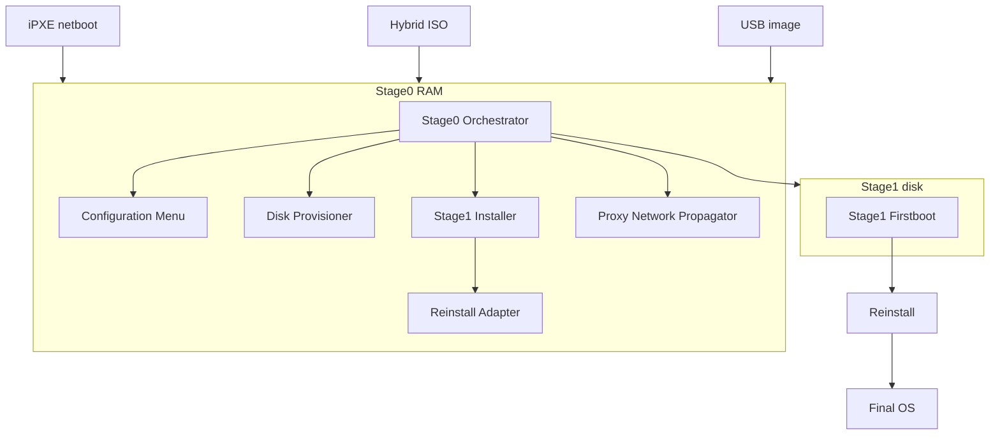
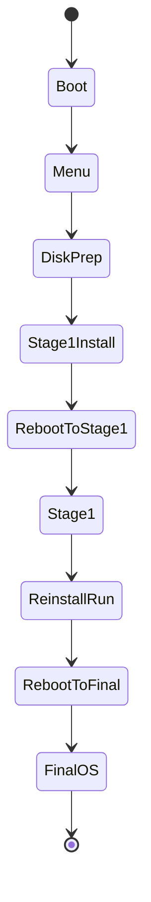

# Design Document — stage0-netboot-image

## Overview

This feature delivers a menu-driven "stage0" installer image that boots a machine from the network, a USB drive, or an ISO, and drives an unattended operating-system deployment by delegating the actual OS installation to the `reinstall` tool.

**Purpose**: Give operators a single, network-bootable path to deploy Linux or Windows onto bare-metal or VPS machines that have a blank or repurposed disk — no physical media and no pre-existing OS required.

**Users**: System operators deploying fleets or individual machines; developers testing installs in labs.

**Impact**: Transforms the empty `netinstall` repository into a working boot-image pipeline. The stage0 image manufactures the two preconditions `reinstall` requires (a running OS on disk and an on-disk bootloader) by installing a minimal stage1 system, then reboots into it so `reinstall` can run.

### Goals
- One stage0 image bootable three ways: network boot, USB, and ISO.
- A configuration menu that collects disk, OS, credentials, and network/proxy settings before any disk write.
- Safe disk preparation (identity display + full-wipe confirmation + wrong-disk protection).
- Unattended handoff: stage0 installs stage1, stage1 auto-runs `reinstall`, machine ends in the final OS.
- Proxy/network settings propagate to every download stage.

### Non-Goals
- Reimplementing OS installation (delegated to `reinstall`).
- Fleet management, inventory, or a control-plane server.
- Secure Boot signing of the boot chain.
- A graphical/web UI; the menu is a text UI on serial/console.

## Boundary Commitments

### This Spec Owns
- The stage0 payload: early-boot orchestration, configuration menu, disk preparation, and stage1 installation.
- The `DeploymentConfig` data contract (schema + the JSON written to stage1).
- The boot artifacts (netboot tree, ISO, USB image) and their build script.
- The `reinstall` integration bundle: pinned `reinstall.sh`/`trans.sh`/`initrd-network.sh`, the proxy patch, and the config→argv/env mapping.
- The stage1 firstboot hook that invokes `reinstall`.

### Out of Boundary
- The OS-install logic inside `reinstall`/`trans.sh` (upstream tool, consumed as-is apart from the proxy patch).
- Secure Boot signing (adjacent: machines must disable Secure Boot or use a signed path).
- Fleet management, orchestration servers, or any state beyond a single deployment run.
- The final OS's post-install configuration beyond credentials.

### Allowed Dependencies
- `reinstall` (pinned release) — may be patched only for proxy-env propagation.
- Alpine Linux tooling: netboot artifacts, `mkinitfs`, `setup-disk`, OpenRC `local.d`.
- Boot tooling: `grub` (bootloader + `grub-mkrescue`), `xorriso`, iPXE, `dnsmasq`.
- No other spec or subsystem may be assumed to exist.

### Revalidation Triggers
- `reinstall.sh` changes its init-hook injection or `trans.sh`/`initrd-network.sh` paths → re-verify the proxy patch.
- `DeploymentConfig` schema changes → re-validate the stage0→stage1 handoff and the menu.
- Alpine `setup-disk` bootloader/partition behavior changes → re-verify disk prep.
- Adding a fourth boot medium or a new OS category → re-check the boot-artifact build and os-catalog.

## Architecture

### Architecture Pattern & Boundary Map

The system is a **boot pipeline** with a strict stage boundary: stage0 runs from RAM, stage1 runs from disk, and the final OS is produced by `reinstall`. A single authoritative `DeploymentConfig` flows across the boundary.



**Selected pattern**: a linear multi-stage pipeline with a data contract (`DeploymentConfig`) as the stage boundary. Stage0's internal components follow a layered dependency direction.

**Dependency direction** (left-to-right; lower layers never call upward):

```
Data (config.schema, os-catalog)  →  Helpers (net/disk/proxy lib)  →  Providers (disk-prep, stage1-install, reinstall-adapter)  →  UI (menu)  →  Orchestrator (stage0-main)
```

- Helpers depend only on Data; Providers depend on Data + Helpers; Menu (UI) depends on Providers; Orchestrator depends on all layers.
- The stage0→stage1 seam is one-way: stage0 writes files into stage1's root; stage1 never calls back into stage0.

### Technology Stack

| Layer | Choice / Version | Role in Feature | Notes |
|-------|------------------|-----------------|-------|
| Base OS | Alpine Linux (pinned, e.g. 3.21 / latest-stable) | Stage0 live root and stage1 install | Same env `reinstall` boots into |
| Initramfs | `mkinitfs` (custom feature) | Build stage0 initramfs with baked payload + tools | `vmlinuz-lts` + `modloop-lts` from netboot |
| Disk install | `setup-disk -m sys` (alpine-conf) | Install stage1 to disk with bootloader | UEFI via `USE_EFI`/auto-detect |
| Bootloader | grub (BIOS `i386-pc`, UEFI `x86_64-efi`) | Stage1 boot + ISO/USB boot | `reinstall` chains into grub |
| TUI | `dialog` | Configuration menu | |
| Netboot | iPXE + `dnsmasq` (DHCP+TFTP+HTTP) | PXE/UEFI boot chain | `undionly.kpxe` / `ipxe.efi` |
| ISO/USB | `grub-mkrescue` / `xorriso -isohybrid-mbr` | Hybrid BIOS+UEFI ISO, dd-able USB | One image for both |
| Rescue | `dropbear` (SSH), serial console, HTTP log | Observability + rescue | Mirrors `reinstall`'s log-viewer pattern |
| Scripting | POSIX shell + busybox | Stage0/stage1 logic | JSON parsed with a small validator |

## File Structure Plan

All files are new (repository is empty).

```
netinstall/
├── build/
│   ├── Dockerfile               # Alpine build container: mkinitfs, grub, xorriso, dialog, parted, sfdisk, dropbear
│   └── build.sh                 # Assemble netboot/, iso/, usb/ from stage0 payload + kernel + modloop
├── stage0/
│   ├── payload/
│   │   ├── etc/local.d/stage0.start       # OpenRC boot entry: exec stage0-main
│   │   ├── etc/netinstall/config.schema.json  # DeploymentConfig JSON Schema
│   │   ├── etc/netinstall/os-catalog.json     # OS/version → reinstall argv mapping
│   │   └── usr/local/sbin/
│   │       ├── stage0-main       # Orchestrator: firmware/network detect, drive the flow
│   │       ├── menu              # dialog TUI: disk, OS, credentials, proxy
│   │       ├── disk-prep         # setup-disk: partition + grub + minimal base OS
│   │       ├── stage1-install    # chroot injection of bundle/config/firstboot
│   │       ├── reinstall-adapter # config → reinstall argv/env; owns pinned bundle + patch
│   │       ├── rescue            # Rescue & Observability: dropbear SSH + serial + HTTP log
│   │       └── lib/              # net.sh, disk.sh, proxy.sh (helpers)
│   └── features.d/stage0.files   # mkinitfs feature: bake payload + tool binaries into initramfs
├── reinstall/
│   ├── reinstall.sh              # pinned upstream
│   ├── trans.sh                  # pinned upstream
│   ├── initrd-network.sh         # pinned upstream
│   └── patches/proxy-env.patch   # inject proxy env into reinstall's init hook
├── stage1/
│   ├── etc/local.d/stage1.start  # firstboot: read config.json → run reinstall-adapter output
│   └── etc/profile.d/99-proxy.sh # proxy env for stage1 shell
├── boot/
│   ├── menu.ipxe                 # iPXE script (kernel/initrd/boot over HTTP)
│   ├── dnsmasq.conf              # DHCP+TFTP; client-arch → undionly.kpxe / ipxe.efi
│   └── grub.cfg                  # ISO/USB grub menu → same kernel/initramfs/modloop
└── tests/
    ├── unit/                     # argv mapping, config validation, proxy env generation
    ├── integration/              # disk-prep on loop device, chroot injection, patch apply
    └── e2e/                      # QEMU netboot + ISO → final OS; proxy traversal
```

Responsibilities are one-per-file; `lib/` holds only pure helpers with no orchestration. The `reinstall/` and `stage1/` files are static payloads copied into stage0/stage1 by the build and by `stage1-install` respectively.

## System Flows

### Boot-to-deploy lifecycle



Key decisions beyond the diagram:

- **Boot failure or menu abort** returns to a rescue shell and never reaches `DiskPrep` (no disk write before confirmation).
- **`DiskPrep` and `Stage1Install` run only after the operator confirms the full-wipe at the menu.**
- **The stage0→stage1 seam** is the `DeploymentConfig` JSON plus the pinned `reinstall` bundle placed into the stage1 root by `stage1-install`.
- **Proxy env** is exported in stage0 (from config), baked into stage1 via `profile.d`, and forwarded into `reinstall`'s install environment by the patched init hook — so every download stage honors it.

## Requirements Traceability

| Requirement | Summary | Components | Interfaces | Flows |
|-------------|---------|------------|------------|-------|
| 1.1 | Ship three boot images | build.sh, boot/* | build outputs | Boot |
| 1.2 | Boot from any medium w/o pre-existing OS | build.sh, boot/* | kernel+initramfs+modloop | Boot |
| 1.3 | BIOS and UEFI | build.sh, boot/* | grub/iPXE config | Boot |
| 1.4 | Boot failure → no disk write | Stage0 Orchestrator | rescue shell | Boot |
| 2.1 | Present menu | Configuration Menu | dialog TUI | Menu |
| 2.2 | Menu collects disk/OS/credentials/network/proxy | Configuration Menu | DeploymentConfig | Menu |
| 2.3 | No write during config | Configuration Menu | — | Menu |
| 3.1 | Display disk identity | Configuration Menu | disk lib | Menu |
| 3.2 | Confirm full erase | Configuration Menu | DeploymentConfig | Menu |
| 3.3 | No confirm → no modify | Configuration Menu | — | Menu |
| 4.1 | Offer OS catalog | Configuration Menu | os-catalog.json | Menu |
| 4.2 | Record + drive install | Reinstall Adapter | config→argv map | ReinstallRun |
| 4.3 | Unsupported OS → report | Reinstall Adapter | error envelope | Menu |
| 5.1 | Specify credentials | Configuration Menu | DeploymentConfig | Menu |
| 5.2 | Final OS accepts credentials | Reinstall Adapter | reinstall `--username/--password/--ssh-key` | ReinstallRun |
| 6.1 | Partition + bootloader | Disk Provisioner | setup-disk/grub | DiskPrep |
| 6.2 | Bootloader BIOS + UEFI | Disk Provisioner | grub targets | DiskPrep |
| 6.3 | Only selected disk | Disk Provisioner | `/dev/disk/by-id` pin | DiskPrep |
| 7.1 | Install minimal OS + reinstall + config | Stage1 Installer | chroot injection | Stage1Install |
| 7.2 | Auto-start install on next boot | Stage1 Firstboot | `local.d` start | Stage1 |
| 7.3 | Reboot into minimal system | Stage0 Orchestrator | reboot | RebootToStage1 |
| 8.1 | Specify proxy/bypass/DHCP/static | Configuration Menu | DeploymentConfig | Menu |
| 8.2 | Apply proxy to all downloads | Proxy Network Propagator | env + reinstall patch | ReinstallRun |
| 8.3 | Unreachable proxy → report + recoverable | Proxy Network Propagator | rescue shell | ReinstallRun |
| 9.1 | Boot final OS | Reinstall Adapter (reinstall) | reinstall | RebootToFinal |
| 9.2 | No input after stage1 reboot | Stage1 Firstboot | — | Stage1 |
| 10.1 | Progress via serial + HTTP | Rescue & Observability | serial, log viewer | Stage1/ReinstallRun |
| 10.2 | Recovery shell/SSH on failure | Rescue & Observability | dropbear | Any |
| 10.3 | Failure → bootable/reachable | Rescue & Observability | rescue shell/SSH | Any |

## Components and Interfaces

| Component | Layer | Intent | Req Coverage | Key Dependencies (P0/P1) | Contracts |
|-----------|-------|--------|--------------|--------------------------|-----------|
| Stage0 Orchestrator | Orchestrator | Early boot, firmware/network detect, drive flow | 1.4, 7.3 | Menu, DiskProv, Stage1Inst, ProxyLib (P0) | State |
| Configuration Menu | UI | Collect and validate DeploymentConfig via dialog | 2.1, 2.2, 2.3, 3.1, 3.2, 3.3, 4.1, 5.1, 8.1 | os-catalog, config.schema (P0) | State |
| Disk Provisioner | Provider | Partition, install grub, and install minimal base OS on selected disk | 6.1, 6.2, 6.3 | disk lib, setup-disk/grub (P0) | State |
| Stage1 Installer | Provider | chroot-inject bundle/config/firstboot into installed system | 7.1 | ReinstallAdapter, DiskProv (P0) | State |
| Stage1 Firstboot | Stage1 runtime | Auto-run reinstall from config on next boot | 7.2, 9.2 | config.json, ReinstallAdapter (P0) | State |
| Reinstall Adapter | Provider | Config → reinstall argv/env; owns pinned bundle + patch | 4.2, 4.3, 5.2, 9.1 | os-catalog, reinstall bundle (P0) | Service |
| Proxy Network Propagator | Helper | Export + forward proxy env across stages | 8.2, 8.3 | proxy lib, reinstall patch (P0) | State |
| Rescue & Observability | Cross-cutting | serial + dropbear SSH + HTTP log | 10.1, 10.2, 10.3 | dropbear, log viewer (P1) | State |

### Orchestrator

#### Stage0 Orchestrator

| Field | Detail |
|-------|--------|
| Intent | Boot entrypoint that sequences menu → disk-prep → stage1-install → reboot |
| Requirements | 1.4, 7.3 |

**Responsibilities & Constraints**
- Detect firmware (BIOS/UEFI) and bring up network (via `Proxy Network Propagator`).
- Run the menu; gate all disk-touching steps behind the operator's confirmation.
- On boot/menu failure, drop to a rescue shell and never write to disk.
- After stage1 install, reboot into the disk (and take no further operator input).

**Dependencies**
- Inbound: `local.d/stage0.start` — boot trigger (P0)
- Outbound: Menu, Disk Provisioner, Stage1 Installer, Proxy Network Propagator — orchestration (P0)

**Contracts**: State [x]

##### State Management
- State model: a single `DeploymentConfig` in memory, written once to stage1.
- Persistence & consistency: config is the only cross-component state; no other persistence in stage0.
- Concurrency: single-threaded boot script; no concurrent mutation.

### UI

#### Configuration Menu

| Field | Detail |
|-------|--------|
| Intent | Collect and validate the DeploymentConfig via a dialog TUI |
| Requirements | 2.1, 2.2, 2.3, 3.1, 3.2, 3.3, 4.1, 5.1, 8.1 |

**Responsibilities & Constraints**
- Present the menu (2.1) and collect disk, OS, credentials, and network/proxy choices (2.2).
- Display disk identity and require full-wipe confirmation (3.1, 3.2); write nothing until confirmed (2.3, 3.3).
- Offer the OS catalog and validate the selection (4.1); validate all config against the schema before committing.

**Dependencies**
- Inbound: Stage0 Orchestrator — launches the menu (P0)
- Outbound: os-catalog.json — catalog (P0); config.schema.json — validation (P0)

**Contracts**: State [x]

### Providers

#### Reinstall Adapter

| Field | Detail |
|-------|--------|
| Intent | Translate `DeploymentConfig` into `reinstall` argv/env and supply the pinned bundle |
| Requirements | 4.2, 4.3, 5.2, 9.1 |

**Responsibilities & Constraints**
- Own the pinned `reinstall` bundle (reinstall.sh, trans.sh, initrd-network.sh) and the proxy patch.
- Map `config.os` (via `os-catalog.json`) to `reinstall` argv; reject unsupported selections before any write.
- Map credentials/access to `--username/--password/--ssh-key/--ssh-port/--web-port/--frpc-config`.

**Dependencies**
- Inbound: Stage1 Installer — requests bundle + argv (P0)
- Outbound: os-catalog.json — argv mapping (P0)
- External: `reinstall` bundle — OS install (P0)

**Contracts**: Service [x]

##### Service Interface
```shell
# map_config_to_reinstall(config_json_path) -> emits:
#   argv: reinstall.sh positional + flags
#   env:  http_proxy https_proxy all_proxy no_proxy github_proxy
map_config_to_reinstall "/etc/netinstall/config.json"
```
- Preconditions: `config.json` validates against `config.schema.json`; os selection present in `os-catalog.json`.
- Postconditions: emits a complete `reinstall.sh` command line and proxy env block.
- Invariants: never emits credentials into a kernel cmdline (secrets stay in `config.json`).

#### Disk Provisioner

| Field | Detail |
|-------|--------|
| Intent | Make the selected disk bootable: partition, install grub, and install the minimal base OS |
| Requirements | 6.1, 6.2, 6.3 |

**Responsibilities & Constraints**
- Operate only on the disk pinned by `/dev/disk/by-id` (from `config.targetDisk`).
- Run the standard disk install to partition the disk, install grub for the detected firmware (`i386-pc` for BIOS, `x86_64-efi` for UEFI), and install the minimal base OS.
- Fail fast and leave the machine recoverable if no suitable disk exists.

**Dependencies**
- Inbound: Menu — target disk + confirmation (P0)
- Outbound: disk lib, `setup-disk`/`grub` — partition + bootloader + base OS (P0)

**Contracts**: State [x]

#### Stage1 Installer

| Field | Detail |
|-------|--------|
| Intent | Inject the deployment payload into the disk-installed minimal system |
| Requirements | 7.1 |

**Responsibilities & Constraints**
- Chroot into the disk-installed system produced by the Disk Provisioner and place: the reinstall bundle, `config.json`, `profile.d/99-proxy.sh`, and `local.d/stage1.start`.
- Ensure `local.d` is enabled so stage1 firstboot runs on the next boot.

**Dependencies**
- Inbound: Orchestrator — after Disk Provisioner (P0)
- Outbound: Reinstall Adapter — bundle + argv (P0); Disk Provisioner — installed disk (P0)

**Contracts**: State [x]

### Stage1 Runtime

#### Stage1 Firstboot

| Field | Detail |
|-------|--------|
| Intent | Read DeploymentConfig on first boot and auto-run reinstall |
| Requirements | 7.2, 9.2 |

**Responsibilities & Constraints**
- Run on the first boot of the disk-installed minimal system via `local.d`.
- Read `/etc/netinstall/config.json`, map it through the Reinstall Adapter, and launch `reinstall.sh` with no operator input.

**Dependencies**
- Inbound: Stage1 Installer — places the script and config (P0)
- Outbound: Reinstall Adapter output — argv/env (P0); `config.json` — config (P0)

**Contracts**: State [x]

### Helpers

#### Proxy Network Propagator

| Field | Detail |
|-------|--------|
| Intent | Read/export proxy env and forward it to stage1 and the reinstall install env |
| Requirements | 8.2, 8.3 |

**Responsibilities & Constraints**
- Export `http_proxy/https_proxy/all_proxy/no_proxy/github_proxy` in stage0 from `config.proxy` + `config.network`.
- Bake `profile.d/99-proxy.sh` into stage1; ensure the patched `reinstall.sh` forwards the same vars into its install environment.
- If the proxy is unreachable, report the network error and drop to the rescue shell.

**Dependencies**
- Inbound: Menu — proxy/network config (P0)
- Outbound: proxy lib — env construction (P0); reinstall patch — forwarding (P0)

**Contracts**: State [x]

### Cross-cutting

#### Rescue & Observability

| Field | Detail |
|-------|--------|
| Intent | Expose progress and a recovery path at every stage |
| Requirements | 10.1, 10.2, 10.3 |

**Responsibilities & Constraints**
- Provide serial-console progress and an HTTP log during stage0/stage1 and reinstall.
- Provide a dropbear SSH rescue shell (key-based) on failure.
- Keep the machine bootable/reachable so the operator can retry.

**Dependencies**
- Inbound: all components — failure signals (P1)
- External: `dropbear`, log viewer — rescue + progress (P1)

**Contracts**: State [x]

## Data Models

The only persistent data is the `DeploymentConfig`, the stage0→stage1 contract. It is validated against `config.schema.json` at every boundary.

### DeploymentConfig (JSON Schema summary)

| Field | Type | Required | Description |
|-------|------|----------|-------------|
| `targetDisk` | object | yes | `{ id (by-id path), model, serial, size }` — the confirmed disk |
| `os` | object | yes | `{ category: "linux"\|"windows"\|"dd", distro, version, extra: object }` |
| `credentials` | object | no | `{ username, password, sshKey, sshPort }` |
| `network` | object | yes | `{ mode: "dhcp"\|"static", ipv4, gateway, dns }` |
| `proxy` | object | no | `{ http, https, all, noProxy: [string], githubProxy }` |
| `access` | object | no | `{ webPort, frpcConfig }` |

### Domain Model
- The aggregate is `DeploymentConfig`; it is immutable after the menu commits it.
- `os.category` is a closed enum; `os.extra` is validated per category (e.g. Windows `imageName`/`lang`, dd `img` URL).
- Invariants: `targetDisk.id` must resolve via `/dev/disk/by-id`; `os` must be present in `os-catalog.json`; secrets are never placed in `/proc/cmdline`.

### Data Contracts & Integration
- `os-catalog.json` maps `{category, distro, version}` → reinstall argv fragments. Its schema is versioned alongside the pinned reinstall release.
- `config.json` is the sole cross-stage payload; stage1 reads it at firstboot and does not re-prompt.

## Error Handling

### Error Strategy
Fail fast and return to a recoverable state; never write to disk on validation or boot failure.

### Error Categories and Responses
- **Boot failure** → rescue shell, no disk write (1.4).
- **Unconfirmed wipe** → abort to menu (3.3).
- **Unsupported OS** → report the selection, no disk write (4.3).
- **Config validation failure** → reject at the menu before committing.
- **Disk-prep failure** (no disk, unsupported firmware) → report + rescue shell (6.1/6.3).
- **Unreachable proxy** → report network error + rescue shell; machine recoverable (8.3).
- **Install failure** → rescue SSH; stage1 remains bootable (10.2/10.3).

### Monitoring
- Serial console + HTTP log viewer at every stage; dropbear SSH for interactive rescue.

## Testing Strategy

Derived from the acceptance criteria.

- **Unit Tests**
  1. `reinstall-adapter` argv mapping for every `os-catalog` entry (linux/windows/dd) — exact argv + flags (4.2).
  2. `config.schema.json` validation — accept valid configs, reject invalid/missing fields (2.2, 5.1, 8.1).
  3. Proxy env construction, including `no_proxy` and `github_proxy` (8.2).
- **Integration Tests**
  1. `disk-prep` — run the real command and assert `setup-disk` is invoked with valid syntax (no `Illegal option`); full partition + grub install for `i386-pc`/`x86_64-efi` is deferred to E2E, because Alpine `setup-disk` excludes loop devices (6.1, 6.2).
  2. `stage1-install` chroot injection — config.json, firstboot, reinstall bundle land at the correct paths (7.1).
  3. `proxy-env.patch` applies cleanly to the pinned `reinstall.sh`; the injected init hook exports the proxy vars (8.2).
- **E2E Tests (QEMU/KVM)**
  1. Netboot → scripted menu (disk + OS) → stage1 boots → reinstall runs → final OS boots (1, 7, 9).
  2. UEFI ISO boot reaches the menu (1.3).
  3. Unsupported OS selection → reported, no disk write (4.3).
  4. Run behind a local HTTP proxy and verify all download stages traverse it (8.2, 8.3).

## Security Considerations

- Credentials and SSH keys live only in `config.json` on the target disk (permissions `0600`), wiped when `reinstall` erases the disk; never placed in `/proc/cmdline`.
- Rescue SSH uses a key (dropbear), not a password.
- The disk is pinned by `/dev/disk/by-id` and its identity is re-displayed before wipe to prevent wrong-disk writes.

## Performance & Scalability

- Stage0 is an Alpine live system, so it boots and runs within modest RAM; the build keeps the baked tool set minimal (menu, partition, grub, rescue) to preserve this.
- No scaling targets apply; this is a single-machine boot pipeline.
